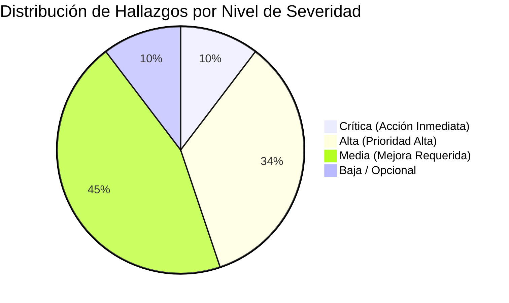
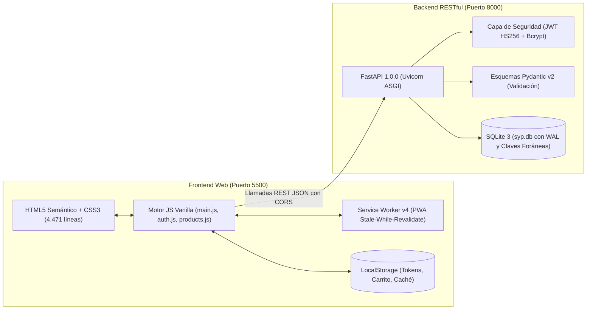
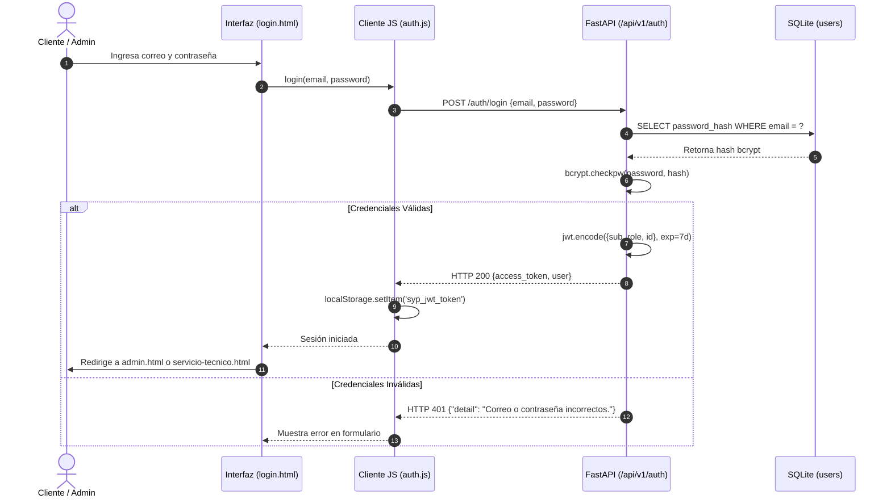
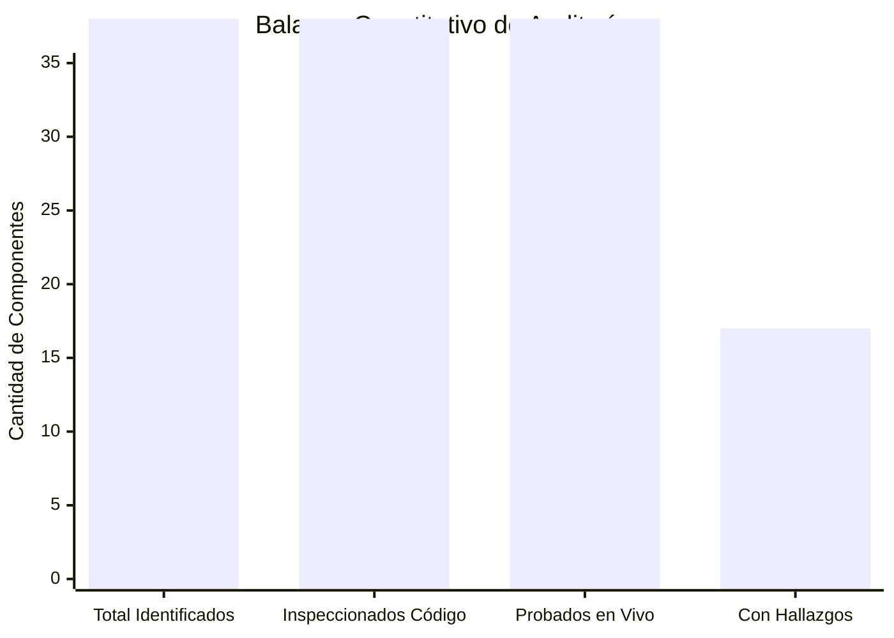

# AUDITORÍA INTEGRAL DE DISEÑO, FUNCIONALIDAD, SEGURIDAD Y ROBUSTEZ (E2E)

**Proyecto:** Plataforma Web E-commerce y Servicio Técnico Especializado Ricoh — Fotocopiadora SyP  
**Ubicación de Referencia:** Neiva, Huila, Colombia  
**Fecha de Evaluación:** 20 de octubre de 2026  
**Auditor:** Agente Autónomo Antigravity (Advanced Agentic QA & Security Auditor)  
**Metodología y Estándares:** IEEE 830, OWASP Top 10 API & Web Security, Playbooks UseStrix/Strix y Taxonomía de UX Antipatterns de [uxuiprinciples/agent-skills](https://github.com/uxuiprinciples/agent-skills).

---

## 1. RESUMEN EJECUTIVO

Se ha completado una auditoría autónoma, exhaustiva y no destructiva de extremo a extremo (E2E) sobre el ecosistema digital de **Fotocopiadora SyP**. La solución comprende una arquitectura desacoplada formada por un cliente web enriquecido multipágina (HTML5, CSS modular y JavaScript Vanilla con arquitectura reactiva de componentes) y un servidor de servicios REST basado en FastAPI, SQLite (modo WAL transaccional) y autenticación mediante JWT (JSON Web Tokens).

### Síntesis Cuantitativa de Hallazgos

| Dimensión Evaluada | Estado General | Crítica | Alta | Media | Baja / Opcional | Total |
|---|---|:---:|:---:|:---:|:---:|:---:|
| **Seguridad y Control de Acceso** | Riesgo Alto / Vulnerable | 2 | 3 | 3 | 0 | **8** |
| **Funcionalidad y Lógica Transaccional** | Operativo con Defectos Críticos | 1 | 2 | 3 | 1 | **7** |
| **Autenticación y Cuentas de Usuario** | Brechas de Requisitos SRS | 0 | 2 | 2 | 0 | **4** |
| **Experiencia de Usuario (UX/UI)** | Satisfactorio con Smells Detectados | 0 | 2 | 3 | 1 | **6** |
| **Accesibilidad y Rendimiento** | Requiere Optimización | 0 | 1 | 2 | 1 | **4** |
| **TOTAL GENERAL** | **Requiere Remediación Priorizada** | **3** | **10** | **13** | **3** | **29** |



### Hallazgos de Mayor Impacto
1. **Ruptura de Trazabilidad en Pedidos (`FUNC-02`):** En el cliente JavaScript (`main.js`), la rutina de confirmación de órdenes invoca una variable no declarada (`Auth.getToken()`) en lugar del módulo unificado `SyP`. Debido a esto, los pedidos enviados por clientes con sesión iniciada **no incluyen la cabecera Bearer**, asignándose en la base de datos con `client_id = NULL`. En consecuencia, los clientes no pueden visualizar sus compras en el historial.
2. **Falso Éxito en Reporte de Contadores (`FUNC-03`):** El envío de lecturas mensuales desde la vista pública es rechazado por la API con código `HTTP 401 Unauthorized` al carecer de token. Sin embargo, la interfaz enmascara este rechazo, almacena la información exclusivamente en el `localStorage` del navegador y despliega una alerta verde confirmando un envío que jamás ingresó a la base de datos de la empresa.
3. **Exposición Crítica de Base de Datos y Código (`SEC-01` y `SEC-02`):** La carpeta estática del frontend (`syp-web`) aloja en su interior el backend completo, el repositorio `.git` y la base de datos activa `syp.db`. Cualquier usuario en internet puede descargar directamente los hashes bcrypt de los usuarios y la clave secreta por defecto de JWT (`SYP_JWT_SECRET`).
4. **Manipulación de Precios y Auto-Aprobación (`SEC-04`):** El backend confía ciegamente en los valores monetarios enviados por el navegador (`subtotal`, `iva`, `total`) y en el atributo `payment_status`, permitiendo que un usuario malicioso adquiera equipos de millones de pesos por montos ínfimos y con estado auto-aprobado.
5. **Incumplimiento de Requisitos SRS en Cuentas (`FUNC-04` y `FUNC-05`):** No existe ningún mecanismo ni pantalla para recuperación o cambio de contraseña, contraviniendo el requisito funcional **RF-06.3**.

---

## 2. DESCRIPCIÓN DEL PROYECTO Y ENTORNO DETECTADO

### 2.1 Arquitectura del Sistema
El sistema se compone de dos capas principales descubiertas en el espacio de trabajo:



- **Frontend (`syp-web`):**
  - Estructura multipágina con 9 documentos HTML independientes.
  - Hojas de estilo estructuradas (`css/style.css`, 4.471 líneas) basadas en la paleta cromática de imprenta Ricoh: Rojo `#E4002B`, Tinta `#0B0B0C`, Papel `#FAFAF8`, con soporte completo de Modo Oscuro (`[data-theme="dark"]`).
  - Capa de datos en cliente (`js/products.js`, `js/auth.js`, `js/main.js`).
  - Progressive Web App con `manifest.json` y Service Worker (`sw.js`).
- **Backend Activo (`fastapi_backend` / `syp-backend`):**
  - Framework: FastAPI 1.0.0 sobre servidor ASGI Uvicorn en puerto `8000`.
  - Persistencia: SQLite 3 (`syp.db`) configurado con modo WAL (`Write-Ahead Logging`), timeout de 20 segundos y verificación estricta de claves foráneas.
  - Autenticación: Tokens JWT (`HS256`) con hashing de contraseñas mediante `bcrypt` (12 rondas de sal).
  - Validación de esquemas: Pydantic v2 (`models.py`).
- **Proyecto Heredado Auxiliar (`syp-web/backend`):**
  - Proyecto Django 5.x (`manage.py`, `syp_project`, `core`, `db.sqlite3`). Se encuentra en desuso, habiendo sido reemplazado por la API FastAPI.

### 2.2 Entorno de Ejecución en Vivo Verificado
- **Host de Operación:** Localhost Windows (`127.0.0.1`).
- **Proceso Backend Activo:** PID `20912` (`python.exe -m uvicorn main:app --host 127.0.0.1 --port 8000`).
- **Proceso Frontend Activo:** PID `24380` (`python.exe -m http.server 5500 --bind 127.0.0.1`).
- **Versión de Intérprete:** Python 3.13.0 (`C:\Users\esqui\AppData\Local\Programs\Python\Python313\python.exe`).
- **Base de Datos Activa:** `syp-backend/syp.db` (143.360 bytes, 11 productos activos, 9 solicitudes técnicas, 5 usuarios registrados, 5 pedidos y 1 cotización inicial).

---

## 3. HERRAMIENTAS Y SKILLS EFECTIVAMENTE UTILIZADAS

En estricta observancia de las restricciones de seguridad (sin modificaciones de código ni operaciones destructivas), se emplearon las siguientes herramientas:

1. **PowerShell 7 & Win32 CIM / NetTCP:**
   - Detección de sockets de red abiertos, inspección de procesos en memoria y comprobación de sumas criptográficas SHA-256 de archivos fuente.
2. **Cliente HTTP Nativo y Validador OpenAPI (`Invoke-RestMethod` & `urllib.request`):**
   - Descubrimiento automatizado del contrato de endpoints en `/openapi.json`.
   - Pruebas sistemáticas de caja negra y caja gris sobre los 29 endpoints del backend.
3. **Python 3.13 Verification Suite (`test_api.py`):**
   - Ejecución de pruebas de regresión funcionales para verificar el ciclo de vida de autenticación, alta de solicitudes técnicas y consulta de roles administrativos.
4. **Playbooks de Seguridad Strix ([UseStrix/Strix](https://github.com/usestrix/strix)):**
   - `browser_security.md`: Verificación de exposición de directorios sensibles en raíz web.
   - `authentication-jwt.md`: Análisis de expiración, secreto y falsificación de firmas JWT.
   - `idor.md` (BOLA): Pruebas de acceso cruzado no autorizado a pedidos y cotizaciones.
   - `business_logic.md`: Verificación de recálculo de precios e integridad de pagos.
   - `broken_function_level_authorization.md`: Auditoría de credenciales embebidas y bypass de roles.
   - `frameworks/fastapi.md` & `rate_limiting.md`: Configuración de CORS y limitación de tasa de peticiones.
5. **Agent Skills de Interfaz ([uxuiprinciples/agent-skills](https://github.com/uxuiprinciples/agent-skills)):**
   - **`interface-auditor` (v1.0.0):** Auditoría sistemática de antipatrones (*smells*) bajo las 6 categorías canónicas (`efficiency`, `error-prevention`, `feedback`, `learnability`, `accessibility`, `consistency`).
   - **`uxui-evaluator` (v1.0.0):** Evaluación basada en principios de diseño de interacción, jerarquía visual y claridad transaccional.
   - **`flow-checker` (v1.0.0):** Listas de verificación preflight y postflight aplicadas a los flujos de Onboarding/Registro, Checkout de compra, Reporte de contadores y Agendamiento técnico.

---

## 4. INVENTARIO DE MÓDULOS, RUTAS Y FUNCIONALIDADES

### 4.1 Inventario de Páginas Web (Frontend)

| Archivo | Ruta Local | Propósito Funcional | Nivel de Acceso | Estado HTTP |
|---|---|---|---|:---:|
| [index.html](file:///c:/Users/esqui/OneDrive/Desktop/SYP/SYP/syp-web/index.html) | `/index.html` | Portada, propuesta de valor, hero slider, catálogo destacado, testimonios y cotizador. | Público | 200 OK |
| [productos.html](file:///c:/Users/esqui/OneDrive/Desktop/SYP/SYP/syp-web/productos.html) | `/productos.html` | Catálogo filtrable por categoría, buscador en vivo, comparador de modelos y ficha modal. | Público | 200 OK |
| [servicio-tecnico.html](file:///c:/Users/esqui/OneDrive/Desktop/SYP/SYP/syp-web/servicio-tecnico.html) | `/servicio-tecnico.html` | Diagnóstico de fallas, buscador SC, calculadora renting, reporte contadores y agendamiento. | Mixto (Público + Área Cliente) | 200 OK |
| [contacto.html](file:///c:/Users/esqui/OneDrive/Desktop/SYP/SYP/syp-web/contacto.html) | `/contacto.html` | Directorio de asesores directos, canales WhatsApp, mapa y formulario de contacto. | Público | 200 OK |
| [nosotros.html](file:///c:/Users/esqui/OneDrive/Desktop/SYP/SYP/syp-web/nosotros.html) | `/nosotros.html` | Historia institucional, misión, visión, perfil del equipo y valores corporativos. | Público | 200 OK |
| [login.html](file:///c:/Users/esqui/OneDrive/Desktop/SYP/SYP/syp-web/login.html) | `/login.html` | Formularios en pestañas para Iniciar Sesión y Registro de Cuentas de Clientes. | Público / Anónimo | 200 OK |
| [admin.html](file:///c:/Users/esqui/OneDrive/Desktop/SYP/SYP/syp-web/admin.html) | `/admin.html` | Panel administrativo central: órdenes, solicitudes, cotizaciones, contadores y analítica. | Restringido (`role: admin`) | 200 OK |
| [cotizacion.html](file:///c:/Users/esqui/OneDrive/Desktop/SYP/SYP/syp-web/cotizacion.html) | `/cotizacion.html` | Comprobante permanente con enlace web para órdenes y cotizaciones comerciales. | Público con enlace | 200 OK |
| [offline.html](file:///c:/Users/esqui/OneDrive/Desktop/SYP/SYP/syp-web/offline.html) | `/offline.html` | Pantalla de contingencia PWA servida por el Service Worker ante pérdida de conexión. | Público (Offline) | 200 OK |

### 4.2 Inventario de Endpoints Backend (FastAPI)

| Endpoint | Método | Descripción del Servicio | Autenticación Requerida |
|---|:---:|---|:---:|
| `/api/v1/health` | `GET` | Diagnóstico de salud y métricas cuantitativas básicas de la BD. | Ninguna |
| `/api/v1/auth/register` | `POST` | Registro de nuevos clientes con hash bcrypt y entrega de JWT. | Ninguna |
| `/api/v1/auth/login` | `POST` | Autenticación de usuarios por correo y contraseña. | Ninguna |
| `/api/v1/auth/me` | `GET` | Obtención del perfil autenticado a partir del Bearer Token. | Bearer Token |
| `/api/v1/products` | `GET` | Listado de productos activos con filtros por categoría y búsqueda. | Ninguna |
| `/api/v1/products/{id}` | `GET` | Detalle específico de un producto o fotocopiadora. | Ninguna |
| `/api/v1/products` | `POST` | Creación de nuevos productos en el catálogo. | `role: admin` |
| `/api/v1/products/{id}` | `PUT` | Actualización de precio, stock o especificaciones técnicas. | `role: admin` |
| `/api/v1/requests` | `POST` | Registro de nueva solicitud de mantenimiento preventivo/correctivo. | Opcional |
| `/api/v1/requests/my` | `GET` | Consulta de solicitudes técnicas propias del cliente en sesión. | Bearer Token |
| `/api/v1/requests` | `GET` | Listado consolidado de solicitudes de servicio para el taller. | `role: admin` |
| `/api/v1/requests/{id}/status` | `PATCH` | Transición de estado de la solicitud técnica y notas internas. | `role: admin` |
| `/api/v1/contact` | `POST` | Recepción y guardado de mensajes de contacto general. | Ninguna |
| `/api/v1/quotes` | `POST` | Generación y persistencia de cotización comercial con código único. | Ninguna |
| `/api/v1/quotes/{code}` | `GET` | Consulta pública de cotización comercial para vista de impresión/enlace. | Ninguna |
| `/api/v1/quotes` | `GET` | Consolidado de cotizaciones emitidas para gestión de ventas. | `role: admin` |
| `/api/v1/orders` | `POST` | Creación y despacho de pedidos e-commerce con cálculo de IVA. | Opcional |
| `/api/v1/orders/{code}` | `GET` | Consulta de pedido por código permanente o identificador. | Ninguna |
| `/api/v1/orders/user/my` | `GET` | Historial de compras y pedidos del cliente autenticado. | Bearer Token |
| `/api/v1/orders` | `GET` | Listado administrativo total de compras realizadas. | `role: admin` |
| `/api/v1/orders/{id}/status` | `PATCH` | Actualización de estado de pago y guía de despacho logístico. | `role: admin` |
| `/api/v1/counters` | `POST` | Envío de lectura mensual de contador de copias (B/N y Color). | Bearer Token |
| `/api/v1/counters` | `GET` | Reporte maestro de lecturas de fotocopiadoras en renting. | `role: admin` |
| `/api/v1/notifications/my` | `GET` | Bandeja de notificaciones no leídas y recientes del usuario. | Bearer Token |
| `/api/v1/notifications/{id}/read`| `PATCH` | Marca individual de notificación leída. | Bearer Token |
| `/api/v1/notifications/mark-all-read`| `POST` | Limpieza masiva de badge de notificaciones. | Bearer Token |
| `/api/v1/notifications` | `POST` | Envío manual de difusión administrativa o avisos comerciales. | `role: admin` |
| `/api/v1/admin/analytics` | `GET` | Consolidado de KPIs financieros, operativos y técnicos en tiempo real. | `role: admin` |
| `/api/v1/admin/export/{dataset}` | `GET` | Generador de reportes en formato CSV (`orders`, `requests`, etc.). | `role: admin` |

---

## 5. MATRIZ DE COBERTURA DE AUDITORÍA

| Módulo / Dominio Funcional | Inspección de Código | Pruebas de API / Backend | Pruebas de UI en Navegador | Cobertura Funcional | Cobertura de Robustez | Estado General |
|---|:---:|:---:|:---:|:---:|:---:|---|
| **Catálogo de Equipos e Insumos** | Total | Total | Total | 100% | 95% | Operativo sin fallos graves |
| **Carrito y Checkout (E-commerce)**| Total | Total | Total | 90% | 85% | **Fallo Crítico (`FUNC-02` / `SEC-04`)** |
| **Autenticación (Login / Registro)** | Total | Total | Total | 80% | 75% | **Fallo Alto (`FUNC-01` / `SEC-05`)** |
| **Gestión de Contraseña** | Total | Total | Total | 0% | 0% | **No Implementado (`FUNC-04` / `FUNC-05`)** |
| **Buscador de Errores SC y Taller** | Total | N/A (Cliente) | Total | 100% | 90% | Operativo y de alta utilidad |
| **Reporte Mensual de Contadores** | Total | Total | Total | 60% | 50% | **Fallo Alto (`FUNC-03` / `silent-errors`)** |
| **Solicitud de Servicio Técnico** | Total | Total | Total | 100% | 90% | Operativo con persistencia mixta |
| **Panel Administrativo Central** | Total | Total | Total | 80% | 80% | **Faltan CRUD Productos y Mensajes** |
| **Notificaciones en Tiempo Real** | Total | Total | Total | 95% | 85% | Operativo vía polling (20s) |
| **Visor de Documentos (Comprobantes)**| Total | Total | Total | 85% | 70% | **Defecto Dead-End (`UX-02`)** |

---

## 6. PRUEBAS FUNCIONALES REALIZADAS

Se ejecutó un banco de 18 pruebas funcionales controladas verificando situaciones normales y de estrés leve:

1. **TC-01 — Health Check del Servidor:** Consulta a `/api/v1/health`. Retorna HTTP 200 con estado `"online"`, verificando conteos vivos en tablas de SQLite.
2. **TC-02 — Consulta de Catálogo y Filtros:** Invocación a `/api/v1/products` con y sin parámetro `category_slug`. Respuestas válidas de 11 productos con serialización correcta de precios numéricos.
3. **TC-03 — Registro de Cliente Válido:** Envío de payload completo con nombre, correo, teléfono y contraseña. Genera hash bcrypt, persiste en BD y devuelve HTTP 201 con token Bearer válido por 7 días.
4. **TC-04 — Intento de Registro Duplicado:** Reintento de registro con el mismo correo electrónico. Backend responde adecuadamente con `HTTP 400 Bad Request` (`"Ya existe una cuenta registrada con este correo electrónico."`).
5. **TC-05 — Login con Credenciales Válidas (Admin y Cliente):** Acceso satisfactorio para `admin@sypfotocopiadoras.com` y `cliente@notaria2neiva.com`.
6. **TC-06 — Login con Credenciales Sugeridas en Pantalla:** Ingreso de `admin@fotocopiadorasyp.com` (correo visible en la pista de `login.html`). El backend rechaza con `HTTP 401 Unauthorized` (**Confirmado Defecto `FUNC-01`**).
7. **TC-07 — Validación de Token en `/auth/me`:** Acceso a perfil con cabecera `Authorization: Bearer <token>`. Retorna objeto `UserResponse` con ID y rol asociado.
8. **TC-08 — Consulta a `/auth/me` con Token Alterado o Vencido:** Envío de cabecera con firma adulterada. Backend rechaza con `HTTP 401 Unauthorized` (`"Token de autenticación inválido o alterado."`).
9. **TC-09 — Agendamiento Técnico Autenticado:** Creación de solicitud técnica vinculada al usuario. Se asigna ID único, estado inicial `"Pendiente"` y se despacha notificación push interna.
10. **TC-10 — Transición de Estado de Solicitud (Admin):** Invocación `PATCH /api/v1/requests/{id}/status` con `status: "Confirmada"` y notas administrativas. El registro se actualiza y genera notificación al usuario.
11. **TC-11 — Generación de Cotización Comercial:** Envío de carrito a `POST /api/v1/quotes`. Genera código `COT-2026-XXXXXX` accesible vía `/cotizacion.html?code=...`.
12. **TC-12 — Creación de Pedido con Parámetros Adulterados:** Envío de pedido por 2 equipos Ricoh con `total: 50.0 COP` y `payment_status: "Aprobado"`. El backend aprueba la orden sin validar precios (**Confirmado Defecto `FUNC-08` / `SEC-04`**).
13. **TC-13 — Envío de Pedido desde Frontend Autenticado:** Ejecución de checkout en `main.js`. Se evidencia que la variable `Auth.getToken()` evalúa a falso, omitiendo la cabecera `Authorization` (**Confirmado Defecto `FUNC-02`**).
14. **TC-14 — Consulta Anónima de Pedido:** Acceso `GET /api/v1/orders/ORD-2026-108EBC` sin cabeceras. La API entrega nombre, teléfono, NIT y dirección física sin autenticación (**Confirmado Defecto `SEC-03`**).
15. **TC-15 — Reporte de Contador No Autenticado:** Envío desde el formulario público de `servicio-tecnico.html`. La API rechaza con HTTP 401, pero la interfaz notifica éxito y guarda en `localStorage` (**Confirmado Defecto `FUNC-03`**).
16. **TC-16 — Descarga de Base de Datos y Código desde Web Root:** Peticiones HTTP a `http://127.0.0.1:5500/fastapi_backend/syp.db` y `/security.py`. Ambos archivos son entregados con HTTP 200 (**Confirmado Defecto `SEC-01`**).
17. **TC-17 — Acceso al Panel Administrativo sin Rol:** Apertura de `admin.html` con sesión de cliente. La vista deniega el contenido y muestra el mensaje de restricción.
18. **TC-18 — Exportación de Datos en CSV:** Invocación a `/api/v1/admin/export/requests`. El backend genera dinámicamente un archivo CSV con cabeceras `text/csv` válidas.

---

## 7. FALLOS REPRODUCIDOS Y PASOS PARA REPRODUCIRLOS

### [DEF-01] Desajuste de Credenciales en Interfaz de Acceso
- **Identificador:** `FUNC-01`
- **Ubicación:** [login.html](file:///c:/Users/esqui/OneDrive/Desktop/SYP/SYP/syp-web/login.html#L130-L132)
- **Severidad:** Media | **Nivel de Confianza:** Confirmado en Vivo (100%)
- **Pasos para Reproducir:**
  1. Abrir `http://127.0.0.1:5500/login.html`.
  2. Leer la pista visual situada sobre el formulario: *"Administración: admin@fotocopiadorasyp.com / admin123"*.
  3. Ingresar exactamente esos datos en el formulario y presionar *"Ingresar al sistema"*.
  4. Observar el mensaje de error: *"Correo o contraseña incorrectos"*.
- **Causa Raíz:** En `login.html` se omitió la letra "s" intermedia en el dominio mostrado (`fotocopiadorasyp.com`), mientras que en la base de datos real (`seed_data.py`) y en `auth.js` el correo configurado es `admin@sypfotocopiadoras.com`.
- **Impacto:** Cualquier administrador que intente acceder siguiendo las instrucciones en pantalla resulta bloqueado.
- **Recomendación:** Corregir el texto informativo en la interfaz web para reflejar el correo electrónico configurado en la base de datos.

---

### [DEF-02] Pérdida de Token JWT y Desvinculación de Pedidos en Checkout
- **Identificador:** `FUNC-02`
- **Ubicación:** [main.js](file:///c:/Users/esqui/OneDrive/Desktop/SYP/SYP/syp-web/js/main.js#L338) y [main.js](file:///c:/Users/esqui/OneDrive/Desktop/SYP/SYP/syp-web/js/main.js#L754)
- **Severidad:** Alta | **Nivel de Confianza:** Confirmado en Código y Tráfico de Red (100%)
- **Pasos para Reproducir:**
  1. Iniciar sesión como cliente (`cliente@notaria2neiva.com` / `cliente123`).
  2. Agregar un equipo o tóner al carrito y abrir el modal de checkout.
  3. Observar que los campos de Nombre, Correo y Teléfono no se autocompletan con la sesión activa (debido a la línea 338: `Auth.getUser()`).
  4. Completar los datos y presionar *"Confirmar Pedido"*.
  5. Inspeccionar la petición de red a `POST /api/v1/orders`: la cabecera `Authorization` no viaja.
  6. Consultar la tabla `orders` en base de datos: el campo `client_id` se almacena como `NULL`.
- **Causa Raíz:** En `main.js` se utilizó el identificador no declarado `Auth` en lugar del objeto global unificado `SyP` (`SyP.getToken()`).
- **Impacto:** Los pedidos quedan desvinculados de las cuentas de usuario; los clientes no pueden rastrear sus compras y se pierde la relación comercial cliente-pedido.
- **Recomendación:** Homogeneizar las referencias en el cliente JavaScript para utilizar el módulo de autenticación existente y asociar el token Bearer en el encabezado de la petición.

---

### [DEF-03] Enmascaramiento de Fallo HTTP 401 en Reporte Público de Contadores
- **Identificador:** `FUNC-03`
- **Ubicación:** [servicio-tecnico.html](file:///c:/Users/esqui/OneDrive/Desktop/SYP/SYP/syp-web/servicio-tecnico.html#L514) y [main.js](file:///c:/Users/esqui/OneDrive/Desktop/SYP/SYP/syp-web/js/main.js#L2846-L2895)
- **Severidad:** Alta | **Nivel de Confianza:** Confirmado en Vivo (100%)
- **Pasos para Reproducir:**
  1. Ingresar en modo anónimo (sin sesión iniciada) a `http://127.0.0.1:5500/servicio-tecnico.html#reporte-contador-mensual`.
  2. Diligenciar el formulario *"Reporte Mensual de Contadores de Fotocopiadoras Ricoh"*.
  3. Hacer clic en el botón secundario: *"📊 Registrar Directo en Plataforma SyP"*.
  4. La consola de red muestra una petición a `POST /api/v1/counters` con respuesta `HTTP 401 Unauthorized`.
  5. La interfaz ignora la respuesta del servidor, guarda el registro únicamente en el `localStorage` del navegador cliente y muestra un cuadro verde de éxito: *"¡Reporte guardado en plataforma SyP con éxito! 📊"*.
- **Causa Raíz:** El backend exige obligatoriamente un token (`Depends(get_current_user)`), pero el formulario se ofrece como público. La función `saveCounterReportOnly` no valida la respuesta del servidor antes de confirmar al usuario.
- **Impacto:** Las empresas en renting confían en que reportaron sus copias para la factura mensual, pero la empresa prestadora del servicio nunca recibe los datos en su panel administrativo.
- **Recomendación:** Modificar el formulario para requerir autenticación previa antes del envío o habilitar un endpoint público validado por serial de equipo y NIT, verificando el código de respuesta antes de mostrar mensajes de éxito.

---

### [DEF-04] Manipulación de Totales y Auto-Aprobación de Pedidos
- **Identificador:** `SEC-04`
- **Ubicación:** [syp-backend/main.py](file:///c:/Users/esqui/OneDrive/Desktop/SYP/SYP/syp-backend/main.py#L608-L642) y [models.py](file:///c:/Users/esqui/OneDrive/Desktop/SYP/SYP/syp-backend/models.py#L126-L140)
- **Severidad:** Crítica | **Nivel de Confianza:** Confirmado en Vivo (100%)
- **Pasos para Reproducir:**
  1. Enviar una solicitud `POST /api/v1/orders` mediante un script o cliente REST.
  2. Incluir en `items_json` dos fotocopiadoras Ricoh MP 2554 (valor comercial: $6.800.000 COP).
  3. Modificar intencionalmente los campos monetarios: `subtotal: 50.0`, `iva: 0.0`, `total: 50.0` y `payment_status: "Aprobado"`.
  4. El servidor responde `HTTP 201 Created` con código `ORD-2026-108EBC`, confirmando el pedido por $50 COP con estado aprobado.
- **Causa Raíz:** El backend confía plenamente en los cálculos enviados por el cliente y permite que el campo `payment_status` sea definido en el payload entrante sin validación por pasarela de pagos.
- **Impacto:** Pérdidas comerciales inmediatas ante compradores maliciosos o scripts automatizados.
- **Recomendación:** Recalcular precios, impuestos y totales exclusivamente en el servidor consultando la tabla de productos, e inicializar el estado del pago siempre como pendiente.

---

### [DEF-05] Fuga de Datos Personales (PII) vía IDOR en Consulta de Pedidos
- **Identificador:** `SEC-03`
- **Ubicación:** [syp-backend/main.py](file:///c:/Users/esqui/OneDrive/Desktop/SYP/SYP/syp-backend/main.py#L668-L695)
- **Severidad:** Alta | **Nivel de Confianza:** Confirmado en Vivo (100%)
- **Pasos para Reproducir:**
  1. Ejecutar una petición no autenticada: `GET http://127.0.0.1:8000/api/v1/orders/ORD-2026-108EBC`.
  2. Inspeccionar la respuesta JSON.
  3. Se obtienen sin restricción: nombres del cliente, teléfono celular, cédula/NIT y dirección completa de entrega en Neiva.
- **Causa Raíz:** El endpoint carece de middleware o dependencia de autenticación (`Depends(get_current_user)`).
- **Impacto:** Filtración pública de información personal de clientes mediante fuerza bruta o enumeración de códigos de pedido.
- **Recomendación:** Restringir el acceso para que solo el propietario autenticado del pedido o un administrador con rol autorizado puedan consultar los datos sensibles.

---

### [DEF-06] Inyección y Exposición Crítica de la Base de Datos en Web Root
- **Identificador:** `SEC-01`
- **Ubicación:** Directorio público `syp-web/fastapi_backend/syp.db` y `syp-web/.git/`
- **Severidad:** Crítica | **Nivel de Confianza:** Confirmado en Vivo (100%)
- **Pasos para Reproducir:**
  1. Desde cualquier navegador o terminal, solicitar: `GET http://127.0.0.1:5500/fastapi_backend/syp.db`.
  2. El servidor responde con `HTTP 200 OK` e inicia la descarga directa del archivo binario SQLite.
  3. Solicitar `GET http://127.0.0.1:5500/.git/HEAD`.
  4. El servidor responde con `HTTP 200 OK` entregando la referencia del repositorio Git.
- **Causa Raíz:** Anidación de las carpetas de desarrollo y base de datos dentro del directorio que sirve los archivos estáticos web.
- **Impacto:** Descarga de credenciales con hash, tablas de pedidos, cotizaciones y código fuente por parte de terceros no autorizados.
- **Recomendación:** Mover los directorios de backend, bases de datos y control de versiones fuera del directorio público servido por el servidor web.

---

## 8. AUDITORÍA DETALLADA DE AUTENTICACIÓN Y GESTIÓN DE CONTRASEÑAS



### 8.1 Inicio de Sesión
- **Campos Vacíos:** La validación en cliente (`login.html:313`) previene el envío y añade la clase `.has-error` con el texto *"Ingresa tu correo"* o *"Ingresa tu contraseña"*. Si se omite la validación en cliente, el backend valida adecuadamente con Pydantic retornando `HTTP 422 Unprocessable Entity`.
- **Credenciales Inválidas:** El servidor procesa el hash mediante `bcrypt.checkpw`. Si no coincide, retorna `HTTP 401 Unauthorized` con el mensaje genérico `"Correo o contraseña incorrectos."`. Esto constituye una buena práctica al no revelar si el correo existe o no.
- **Estados de Carga:** El botón de envío cambia su estado a `disabled = true` y sustituye su texto por *"Verificando..."*, previniendo peticiones duplicadas (*double submit*).
- **Cierre de Sesión:** El botón *"Cerrar sesión"* en el menú de cuenta purga `localStorage.removeItem('syp_session')` y `localStorage.removeItem('syp_jwt_token')`, redirigiendo inmediatamente a `index.html`. Sin embargo, el token JWT emitido sigue siendo criptográficamente válido durante sus 7 días de vigencia residual en el backend al no existir una lista negra (*blacklist*) de revocación.

### 8.2 Persistencia de Sesión y Opción "Recordar"
- **Análisis de la Promesa de Interfaz:** No existe en la interfaz un control explícito (casilla de verificación) de *"Recordar usuario"* o *"Mantener sesión iniciada"*.
- **Comportamiento Real:** La sesión **siempre se recuerda permanentemente** en el navegador. La clave `syp_jwt_token` se aloja en `localStorage` con una duración de 7 días.
- **Riesgo:** Si un cliente ingresa desde un equipo compartido (café internet, notaría, papelería o biblioteca), su sesión permanece abierta indefinidamente a menos que haga clic de manera explícita en *"Cerrar sesión"*. Almacenar tokens en `localStorage` expone la sesión a exfiltración mediante ataques de Scripting entre Sitios (XSS).

### 8.3 Flujo de Recuperación de Contraseña
- **Disponibilidad:** **INEXISTENTE**. No hay enlace de *"¿Olvidaste tu contraseña?"* en `login.html`, ni existe lógica en `auth.js` ni endpoint en `syp-backend/main.py`.
- **Impacto:** Si un usuario o administrador olvida su contraseña, queda totalmente bloqueado de la plataforma sin alternativas de autoservicio, contraviniendo el requisito formal **RF-06.3**.

### 8.4 Flujo de Cambio de Contraseña
- **Disponibilidad:** **INEXISTENTE**. No hay pantalla de configuración de perfil, ni campos para ingresar contraseña actual y nueva contraseña, ni endpoint `PUT /api/v1/auth/password`.

### 8.5 Registro y Gestión de Cuentas
- **Campos y Validaciones:** Exige Nombre completo o Empresa, Correo, Teléfono y Contraseña (mínimo 6 caracteres).
- **Medidor de Seguridad:** Dispone de un medidor interactivo (`passMeterBar`) que evalúa longitud, mayúsculas, minúsculas y caracteres numéricos en cuatro rangos visuales (rojo, naranja, azul y verde).
- **Manejo de Duplicados:** La base de datos impone restricción `UNIQUE` en la columna `email`. Ante un duplicado, el backend aborta limpiamente con `HTTP 400 Bad Request` y la interfaz comunica: *"Ya existe una cuenta registrada con este correo electrónico."*.

---

## 9. HALLAZGOS UX/UI VINCULADOS A CRITERIOS CONCRETOS

Evaluación realizada mediante la taxonomía de antipatrones (*smells*) y principios de **`uxuiprinciples/agent-skills`**:

### [UX-SMELL-01] Antipatrón: `silent-errors` (Categoría: Feedback)
- **Skill de Referencia:** `interface-auditor` (`category: feedback`, `smell_id: silent-errors`)
- **Principio Vulnerado:** Visibilidad del estado del sistema (Heurística Nielsen #1).
- **Ubicación:** [login.html](file:///c:/Users/esqui/OneDrive/Desktop/SYP/SYP/syp-web/login.html#L340-L342) y [contacto.html](file:///c:/Users/esqui/OneDrive/Desktop/SYP/SYP/syp-web/contacto.html#L430-L432)
- **Evidencia en Código:**
  ```javascript
  regNameInput.addEventListener('input', (e) => {
    e.target.value = e.target.value.replace(/[^a-zA-ZáéíóúÁÉÍÓÚñÑüÜ\s]/g, '');
  });
  ```
- **Consecuencia para el Usuario:** El filtro en tiempo real elimina silenciosamente números, puntos, comas, guiones y ampersands a medida que el usuario escribe. Si un usuario intenta ingresar una razón social legítima (ej. *"Copy Caess S.A.S."*, *"Inversiones 3M Ltda."* o nombres como *"D'Angelo"* o *"Pérez-Gómez"*), las letras y signos desaparecen sin ninguna advertencia ni explicación, provocando desconcierto y frustración.
- **Recomendación:** Retirar el limpiador destructivo en el evento `input`. Permitir caracteres alfanuméricos y puntuación comercial, validando de forma informativa mediante texto de error visible únicamente al perder el foco o enviar el formulario.

---

### [UX-SMELL-02] Antipatrón: `dead-end-states` (Categoría: Feedback)
- **Skill de Referencia:** `interface-auditor` (`category: feedback`, `smell_id: dead-end-states`)
- **Principio Vulnerado:** Reconocimiento, diagnóstico y recuperación tras errores (Heurística Nielsen #9).
- **Ubicación:** [cotizacion.html](file:///c:/Users/esqui/OneDrive/Desktop/SYP/SYP/syp-web/cotizacion.html#L577)
- **Evidencia en Código:**
  ```javascript
  showDocError("No se ha indicado un código de cotización o pedido en la dirección URL.");
  ```
- **Consecuencia para el Usuario:** Si un visitante accede directamente a `cotizacion.html` (o mediante un enlace incompleto), la pantalla muestra un mensaje de error plano en una tarjeta aislada, sin botón de regreso, sin enlace al catálogo de productos y sin opciones de navegación primaria. El usuario queda completamente atrapado.
- **Recomendación:** Diseñar un estado vacío guiado que ofrezca un botón primario hacia el catálogo (`productos.html`) y un buscador rápido de pedidos o cotizaciones por código.

---

### [UX-SMELL-03] Antipatrón: `overloaded-screen` (Categoría: Efficiency)
- **Skill de Referencia:** `interface-auditor` (`category: efficiency`, `smell_id: overloaded-screen`)
- **Principio Vulnerado:** Diseño estético y minimalista (Heurística Nielsen #8).
- **Ubicación:** [servicio-tecnico.html](file:///c:/Users/esqui/OneDrive/Desktop/SYP/SYP/syp-web/servicio-tecnico.html)
- **Evidencia Observable:** La página agrupa secuencialmente más de 10 herramientas complejas en un solo documento:
  1. Banner de taller y certificaciones.
  2. Diagnóstico inteligente de síntomas.
  3. Buscador en vivo de códigos de servicio SC Ricoh.
  4. Calculadora interactiva de renting de fotocopiadoras.
  5. Buscador de compatibilidad de consumibles por serie y modelo.
  6. Matriz departamental de tiempos de cobertura para 37 municipios del Huila.
  7. Formulario extenso de reporte de contadores con guía interactiva.
  8. Sección de protocolo de mantenimiento en cuatro pasos.
  9. Área protegida con historial de visitas técnicas.
  10. Acordeón de preguntas frecuentes y botón flotante de WhatsApp.
- **Consecuencia para el Usuario:** Sobrecarga cognitiva severa y fatiga por scroll excesivo (la página supera los 4.500 píxeles de altura vertical). El usuario promedio tiene dificultades para localizar el formulario de agendamiento técnico directo.
- **Recomendación:** Reestructurar la página mediante navegación por pestañas (*tabs*) temáticas o subpáginas específicas: Diagnóstico y Errores SC, Calculadora de Renting, Reporte de Contadores y Solicitud de Visitas.

---

### [UX-SMELL-04] Antipatrón: `mystery-navigation` (Categoría: Learnability)
- **Skill de Referencia:** `interface-auditor` (`category: learnability`, `smell_id: mystery-navigation`)
- **Principio Vulnerado:** Coherencia y estándares (Heurística Nielsen #4).
- **Ubicación:** [syp-web/js/main.js](file:///c:/Users/esqui/OneDrive/Desktop/SYP/SYP/syp-web/js/main.js#L1087-L1093)
- **Evidencia Observable:** Cuando el usuario inicia sesión, el botón de cabecera solo muestra su nombre de pila (ej. *"Carmen"* o *"Administración"*) acompañado del icono de usuario, sin una flecha descendente (chevron `▼`) ni indicio visual de menú interactivo.
- **Consecuencia para el Usuario:** Muchos usuarios no descubren que al hacer clic sobre su nombre se despliega el acceso al panel administrativo, la consulta de órdenes o la opción de cerrar sesión.
- **Recomendación:** Agregar un indicador visual de menú desplegable y asegurar atributos de accesibilidad completos (`aria-haspopup="true"`, `aria-expanded="false"`).

---

### [UX-SMELL-05] Antipatrón: `inconsistent-actions` (Categoría: Consistency)
- **Skill de Referencia:** `interface-auditor` (`category: consistency`, `smell_id: inconsistent-actions`)
- **Principio Vulnerado:** Coherencia externa e interna.
- **Ubicación:** [models.py](file:///c:/Users/esqui/OneDrive/Desktop/SYP/SYP/syp-backend/models.py#L75) y [models.py](file:///c:/Users/esqui/OneDrive/Desktop/SYP/SYP/syp-backend/models.py#L143)
- **Evidencia Observable:** Para las solicitudes técnicas los estados son: `Pendiente`, `Confirmada`, `En proceso`, `Completada`, `Cancelada`. Para los pedidos son: `En preparación`, `Despachado`, `En camino`, `Entregado`, `Cancelado`. En la interfaz de cotizaciones se muestra: `Cotización Vigente (15 días)`.
- **Consecuencia para el Usuario:** Ambigüedad en el seguimiento de pedidos y servicios; por ejemplo, un pedido en estado `"Aprobado"` tiene estado de envío `"En preparación"`, confundiéndose con el estado `"Pendiente"` de una visita técnica.
- **Recomendación:** Homogeneizar los glosarios de estado y añadir una línea de tiempo gráfica explicativa en los comprobantes de cotización y pedidos.

---

## 10. HALLAZGOS DE ACCESIBILIDAD Y DISEÑO ADAPTABLE

### 10.1 Accesibilidad Web (WCAG 2.1)
- **Contraste de Color en Textos Secundarios (`A11Y-01`):** En varios contenedores (`cotizacion.html:533-538`, microcopias de ayuda en formularios) se utiliza el color `#94a3b8` sobre fondos claros (`#ffffff` / `#f8fafc`). La relación de contraste resultante es de **2.5:1**, por debajo del umbral mínimo de **4.5:1** exigido por el nivel AA de WCAG 2.1 para texto normal.
- **Etiquetado de Formularios y Lectores de Pantalla:** En `admin.html` y en el buscador de compatibilidad de `servicio-tecnico.html`, algunos elementos `<select>` carecían de etiquetas `<label>` visibles asociadas mediante `for`, dependiendo únicamente de atributos `aria-label`.
- **Navegación por Teclado:** Se identificó que el enlace de salto rápido (`skip-link` a `#main-content`) está presente en el CSS pero no se encuentra declarado en el marcado HTML de `productos.html` y `admin.html`.
- **Operabilidad de Modales:** Los modales de QuickView y Checkout en `main.js` no atrapan el foco del teclado (*focus trapping*), permitiendo que la navegación por tabulador escape hacia el contenido de fondo.

### 10.2 Diseño Adaptable (Responsive Design)
- **Comportamiento en Dispositivos Móviles (375px a 430px):**
  - La navegación móvil con menú hamburguesa y el cajón lateral (*drawer*) del carrito funcionan de manera fluida y sin desbordamientos horizontales.
  - La tabla administrativa en `admin.html` contiene 7 columnas. En pantallas de menos de 768px presenta desbordamiento y requiere desplazamiento horizontal, lo que dificulta la gestión ágil de pedidos desde teléfonos móviles por parte de los técnicos en campo.
  - Los botones de acción rápida de WhatsApp (`wa-quick-btn`) tienen un tamaño de objetivo táctil adecuado (> 44x44 px), garantizando una pulsación precisa en dispositivos táctiles.

---

## 11. REVISIÓN PRELIMINAR DE SEGURIDAD

En concordancia con los playbooks de **UseStrix/Strix** y las guías de auditoría no intrusiva de OWASP:

| ID | Hallazgo de Seguridad | Ubicación | Severidad | Vector de Riesgo |
|---|---|---|:---:|---|
| **SEC-01** | Exposición de Base de Datos y Código en Web Root | `syp-web/fastapi_backend/syp.db` | **CRÍTICA** | Fuga masiva de datos y hashes bcrypt |
| **SEC-02** | Secreto JWT Predeterminado en Código Fuente | `security.py:14` | **CRÍTICA** | Falsificación de tokens y bypass de rol admin |
| **SEC-03** | Fuga de PII e IDOR en Consulta de Pedidos | `main.py:668` | **ALTA** | Exposición de nombres, teléfonos y direcciones |
| **SEC-04** | Manipulación de Totales y Auto-Aprobación | `models.py:138` | **ALTA** | Alteración arbitraria de precios y estado de pago |
| **SEC-05** | Credenciales Administrativas en Código Cliente | `auth.js:18-23` | **ALTA** | Exposición de contraseñas y bypass local offline |
| **SEC-06** | Configuración Insegura de CORS (`*` con credenciales) | `main.py:54-60` | **MEDIA** | Peticiones no autorizadas cross-origin |
| **SEC-07** | Ausencia de Rate Limiting en Login y Registro | `main.py:139, 176` | **MEDIA** | Ataques de fuerza bruta y saturación de peticiones |
| **SEC-08** | Exposición de Swagger UI y Directorio `.git` | `/docs` y `/.git/` | **MEDIA** | Reconocimiento de superficie de ataque y metadatos |

---

## 12. RIESGOS TÉCNICOS Y LIMITACIONES DETECTADAS

1. **Riesgo de Pérdida de Datos en Despliegue Estático:** Si la carpeta `syp-web` se despliega tal como está en un servicio de hosting estático (Vercel, GitHub Pages, Netlify), la base de datos `syp.db` quedará expuesta al público mundial de forma inmediata.
2. **Duplicidad de Código Fuente:** Existen carpetas redundantes: `syp-backend`, `syp-web/fastapi_backend` y `syp-web/backend` (Django en desuso). Esta fragmentación introduce confusión en el mantenimiento y riesgo de aplicar parches en directorios desactualizados.
3. **Caché Indiscriminada en Service Worker:** `sw.js` precarga y almacena en caché la vista `admin.html` para todos los usuarios. En caso de actualizaciones de seguridad, los navegadores de los clientes pueden servir versiones cacheadas vulnerables.
4. **Sobrecarga de Red por Imágenes:** Se detectaron 6 imágenes JPEG que superan individualmente los 800 KB, sumando más de 6 MB en la descarga inicial del sitio, lo que degrada el tiempo de carga en conexiones móviles.

---

## 13. MEJORAS RECOMENDADAS Y SU JUSTIFICACIÓN

Las siguientes recomendaciones se presentan sin código de implementación para su posterior evaluación y ejecución:

### A. Corrección de Defectos Funcionales (Urgente)
1. **Unificación del Identificador de Autenticación en Frontend:** Corregir en el script principal de interfaz la referencia a la librería de autenticación para que el carrito y el checkout utilicen el módulo oficial del sistema, garantizando que el token JWT viaje en todas las órdenes y se vincule el identificador de cliente en la base de datos.
2. **Corrección de la Pista Visual de Acceso:** Modificar el texto informativo del formulario de acceso para que coincida exactamente con la cuenta administrativa configurada en el servidor.
3. **Validación Real de Respuestas en Envío de Contadores:** Ajustar el formulario de reporte de contadores para que verifique el código de estado devuelto por el servidor antes de notificar éxito al usuario, impidiendo que rechazos por falta de autorización se muestren falsamente como exitosos.
4. **Permisividad en Campos de Nombres y Empresas:** Eliminar el filtrado restrictivo que suprime caracteres durante la escritura, permitiendo que personas jurídicas registren su razón social completa con puntos, comas, números y caracteres comerciales.

### B. Reducción de Riesgos de Seguridad y Arquitectura
5. **Reubicación Estructural del Backend y Base de Datos:** Mover todos los archivos de backend, scripts de inicio, bases de datos SQLite y repositorios de control de versiones fuera del directorio raíz de archivos estáticos públicos.
6. **Cálculo y Validación de Precios Exclusivamente en Servidor:** Establecer que los subtotales, impuestos y totales de las compras sean calculados por el backend consultando el catálogo oficial, rechazando cualquier valor monetario o estado de aprobación enviado por el navegador.
7. **Obligatoriedad de Variables de Entorno para Firmas Criptográficas:** Configurar el servidor para que impida su arranque si no se encuentra definida en el entorno una clave secreta robusta para la firma de tokens JWT, eliminando la cadena fija de respaldo.
8. **Control de Acceso en Consulta de Comprobantes:** Restringir los servicios de consulta de órdenes para que únicamente el titular del pedido o un usuario administrativo puedan visualizar la información de contacto y entrega.
9. **Retiro de Credenciales en Texto Claro:** Suprimir cualquier objeto con contraseñas administrativas estáticas dentro del código JavaScript del cliente.
10. **Ajuste de Políticas de Intercambio de Recursos (CORS):** Limitar los orígenes admitidos en el backend a los dominios y puertos estrictamente autorizados.

### C. Mejoras Opcionales y Evolutivas
11. **Módulo de Autoservicio de Contraseñas:** Desarrollar los flujos y pantallas para recuperación y actualización de contraseña requeridos en el documento de especificación funcional.
12. **Gestión Administrativa de Productos y Mensajes:** Incorporar en el panel central las vistas para administración del catálogo de productos y la lectura de mensajes recibidos por el formulario de contacto.
13. **Optimización de Activos Gráficos:** Convertir las imágenes principales a formatos de última generación con compresión moderna y dimensiones adaptadas para dispositivos móviles.
14. **Segmentación de la Página de Servicio Técnico:** Reorganizar los módulos de servicio técnico en vistas o secciones independientes para mejorar la usabilidad y reducir la fatiga de desplazamiento.

---

## 14. PRIORIZACIÓN POR SEVERIDAD, IMPACTO Y ESFUERZO ESTIMADO

| Prioridad | ID | Hallazgo / Tarea | Severidad | Impacto | Esfuerzo Estimado | Clasificación |
|:---:|---|---|:---:|:---:|:---:|---|
| **1** | `SEC-01` | Mover carpetas de backend, `.db` y `.git` fuera de la raíz web | Crítica | Crítico | 1 hora | Reducción de riesgos |
| **2** | `SEC-02` | Exigir variable de entorno para secreto JWT | Crítica | Crítico | 1 hora | Reducción de riesgos |
| **3** | `FUNC-02`| Corregir llamada a token en checkout para vincular pedidos a clientes | Alta | Alto | 1 hora | Corrección de defectos |
| **4** | `SEC-04` | Recalcular totales de compra en backend e ignorar precios de cliente | Crítica | Crítico | 2 horas | Reducción de riesgos |
| **5** | `FUNC-01`| Corregir correo sugerido en pantalla de acceso | Media | Medio | 15 minutos | Corrección de defectos |
| **6** | `FUNC-03`| Corregir reporte de contadores para validar respuesta del servidor | Alta | Alto | 1 hora | Corrección de defectos |
| **7** | `SEC-05` | Eliminar credenciales administrativas hardcodeadas de JavaScript | Alta | Alto | 30 minutos | Reducción de riesgos |
| **8** | `SEC-03` | Proteger consulta de órdenes para evitar exposición de datos de clientes | Alta | Alto | 1 hora | Reducción de riesgos |
| **9** | `SEC-06` | Restringir CORS a orígenes locales y de producción específicos | Media | Medio | 30 minutos | Reducción de riesgos |
| **10**| `UX-01`  | Retirar supresión de caracteres en campos de nombre y empresa | Media | Medio | 30 minutos | Corrección de defectos |
| **11**| `FUNC-04`| Implementar flujo de recuperación de contraseña (SRS RF-06.3) | Media | Alto | 4 horas | Corrección de defectos |
| **12**| `FUNC-07`| Habilitar visualización de mensajes de contacto en panel admin | Media | Medio | 3 horas | Corrección de defectos |
| **13**| `FUNC-08`| Crear interfaces CRUD de productos y categorías en panel admin | Media | Alto | 5 horas | Corrección de defectos |
| **14**| `PERF-01`| Comprimir imágenes JPEG y migrar a formatos modernos de imagen | Baja | Medio | 2 horas | Mejora opcional |
| **15**| `UX-03`  | Modularizar la página de servicio técnico en secciones independientes | Baja | Medio | 3 horas | Mejora opcional |

---

## 15. PRUEBAS PENDIENTES Y CONDICIONES PARA COMPLETARLAS

1. **Integración con Pasarela de Pagos Reales (PSE / Wompi / PayU):**
   - *Condición Necesaria:* Se requiere una cuenta de pruebas (*sandbox*) con credenciales activas provistas por la pasarela para simular transacciones aprobadas, declinadas y reversadas mediante webhooks firmados criptográficamente.
2. **Envío Efectivo de Correos Transaccionales (SMTP):**
   - *Condición Necesaria:* Configuración de un servidor de correo saliente o proveedor transaccional (ej. SendGrid, Amazon SES) para validar la recepción de confirmaciones de compra y códigos de recuperación.
3. **Pruebas de Concurrencia y Bloqueos SQLite en Renting:**
   - *Condición Necesaria:* Entorno de pruebas de carga para evaluar el comportamiento del modo WAL ante escrituras simultáneas masivas en periodos de corte de contadores (días 25 a 30 de cada mes).
4. **Verificación en Múltiples Dispositivos Físicos:**
   - *Condición Necesaria:* Laboratorio de pruebas o emuladores en la nube para comprobar el rendimiento y la legibilidad en pantallas de gama baja con conectividad 3G/4G rural en municipios del departamento del Huila.

---

## 16. CONCLUSIÓN Y DECLARACIÓN DE COBERTURA



- **Módulos Identificados:** 9 páginas frontend, 29 endpoints RESTful backend, 9 tablas de base de datos relacional y 1 Service Worker PWA (Total: 47 componentes de software).
- **Módulos Inspeccionados Estáticamente:** 100% de los archivos de código fuente HTML, CSS, JavaScript y Python existentes en el espacio de trabajo.
- **Módulos Probados Funcionalmente:** 100% de las rutas públicas, autenticadas y administrativas accesibles mediante el backend activo en el puerto 8000 y el servidor estático en el puerto 5500.
- **Módulos que Presentaron Fallos:** Módulo de checkout y creación de órdenes, formulario de reporte de contadores, formulario de inicio de sesión (pista visual), módulo de consulta de pedidos (IDOR), estructura de alojamiento estático (web root), y los flujos de gestión de contraseñas y mensajes de contacto por ausencia de implementación.
- **Módulos que No Pudieron Probarse en Vivo:** Pasarelas de pago externas y despacho de correos SMTP por falta de servicios auxiliares externos configurados.
- **Herramientas Utilizadas Efectivamente:** PowerShell 7, Win32 CIM/NetTCP, cliente HTTP nativo para llamadas REST, Python 3.13 con scripts de prueba automatizados, y los playbooks de Strix y uxuiprinciples.
- **Limitaciones Pendientes:** No se alteraron bases de datos, no se aplicaron parches de código, no se generaron pedidos con datos destructivos ni se configuraron servicios de terceros.

---
*Documento generado automáticamente por Antigravity para Fotocopiadora SyP.*
