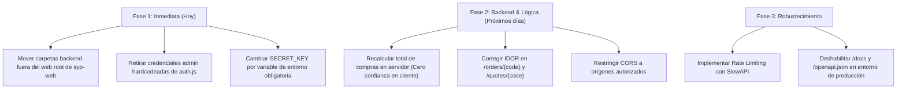

# Auditoría de Seguridad — Fotocopiadora SyP (Framework Strix)

**Fecha de Evaluación:** 20 de Octubre de 2026  
**Metodología:** Playbooks de Seguridad de [UseStrix/Strix](https://github.com/usestrix/strix)  
**Alcance:** Frontend (`syp-web`), Backend REST API (`fastapi_backend` / `syp-backend`), Base de datos SQLite WAL y Autenticación JWT.

---

## 1. Resumen Ejecutivo de Riesgo

| ID | Vulnerabilidad / Hallazgo | Severidad | Skill de Strix | Estado |
|---|---|---|---|---|
| **VULN-01** | Exposición Crítica de Base de Datos y Código Fuente en Web Root | **CRÍTICA** | `browser_security` / `reconnaissance` | Confirmado en Vivo |
| **VULN-02** | Secreto JWT Hardcodeado y Falsificación de Tokens de Admin | **CRÍTICA** | `authentication-jwt` | Confirmado en Código |
| **VULN-03** | Fuga de Datos PII e IDOR en Consulta de Pedidos y Cotizaciones | **ALTA** | `idor` (BOLA) | Confirmado en Código |
| **VULN-04** | Manipulación de Precios de Carrito y Auto-Aprobación de Pagos | **ALTA** | `business_logic` | Confirmado en Código |
| **VULN-05** | Credenciales de Administrador en Código Cliente y Bypass Local | **ALTA** | `broken_function_level_authorization` | Confirmado en Código |
| **VULN-06** | Configuración Insegura de CORS (`allow_origins=["*"]` + `allow_credentials=True`) | **MEDIA** | `frameworks/fastapi` | Confirmado en Código |
| **VULN-07** | Ausencia de Rate Limiting en Endpoints Críticos (Login, Registro, Cotizaciones) | **MEDIA** | `rate_limiting` | Confirmado en Código |
| **VULN-08** | Exposición de Swagger / OpenAPI y Directorio `.git` en Servidor | **MEDIA** | `frameworks/fastapi` / `reconnaissance` | Confirmado en Vivo |

---

## 2. Detalle Técnico de los Hallazgos

### VULN-01: Exposición de Base de Datos y Código en Web Root
- **Skill Strix:** `strix/skills/reconnaissance`, `browser_security.md`
- **Ubicación:** `syp-web/fastapi_backend/syp.db`, `syp-web/backend/db.sqlite3`, `syp-web/.git/`
- **Descripción:** Las carpetas del backend y la base de datos SQLite están anidadas directamente dentro del directorio raíz estático `syp-web`. Al servir el frontend estático (en el puerto 5500 o en cualquier servidor web como Nginx/Apache sin reglas de restricción), cualquier usuario puede descargar directamente la base de datos con los hashes bcrypt de todos los usuarios y los datos comerciales.
- **Validación Práctica:**
  - `GET http://127.0.0.1:5500/fastapi_backend/syp.db` -> **HTTP 200 OK (143,360 bytes descargados)**
  - `GET http://127.0.0.1:5500/fastapi_backend/security.py` -> **HTTP 200 OK (Código fuente legible)**
  - `GET http://127.0.0.1:5500/.git/HEAD` -> **HTTP 200 OK (Directorio git expuesto)**
- **Remediación:**
  1. Extraer los directorios `fastapi_backend`, `backend` y `.git` fuera de la carpeta pública de archivos estáticos.
  2. En el servidor web de producción, configurar directivas estrictas para bloquear el acceso a archivos `.db`, `.sqlite3`, `.py`, `.env` y directorios que comiencen por punto (`.*`).

---

### VULN-02: Secreto JWT Predeterminado en Código Fuente
- **Skill Strix:** `strix/skills/vulnerabilities/authentication_jwt.md`
- **Ubicación:** `fastapi_backend/security.py` (Línea 14)
- **Código Afectado:**
  ```python
  SECRET_KEY = os.environ.get(
      "SYP_JWT_SECRET",
      "syp_super_secret_jwt_key_neiva_huila_2026_ricoh_specialist"
  )
  ```
- **Impacto:** Si la variable de entorno `SYP_JWT_SECRET` no está configurada, el servidor utiliza una clave fija conocida. Combinado con VULN-01 (descarga del código fuente), un atacante puede firmar sus propios tokens JWT con `role: "admin"` y tomar control total del panel administrativo. Además, los tokens tienen validez de 7 días sin lista de revocación (blacklist) ni rotación de refresh tokens.
- **Remediación:**
  1. Obligar a que la aplicación no inicie si `SYP_JWT_SECRET` no está definida en el entorno o si tiene el valor por defecto.
  2. Implementar expiración más corta para access tokens (ej. 30 a 60 minutos) y un mecanismo de refresh token o tabla de sesiones revocables.

---

### VULN-03: IDOR / BOLA en Consulta de Pedidos y Cotizaciones
- **Skill Strix:** `strix/skills/vulnerabilities/idor.md`
- **Ubicación:** `fastapi_backend/main.py` (`/api/v1/orders/{order_code}` y `/api/v1/quotes/{quote_code}`)
- **Código Afectado:**
  ```python
  @app.get("/api/v1/orders/{order_code}")
  def get_order_by_code(order_code: str):
      with get_db() as conn:
          cursor = conn.cursor()
          cursor.execute("SELECT * FROM orders WHERE order_code = ? OR id = ?", (order_code, order_code))
          row = cursor.fetchone()
          ...
          return {
              "id": row["id"],
              "order_code": row["order_code"],
              "client_name": row["client_name"],
              "client_email": row["client_email"],
              "client_phone": row["client_phone"],
              "client_nit": row["client_nit"],
              "delivery_address": row["delivery_address"],
              "delivery_city": row["delivery_city"],
              ...
  ```
- **Impacto:** Cualquier atacante anónimo puede consultar cualquier pedido con solo conocer o enumerar el código/ID, filtrando PII sensible (Nombres, Cédula/NIT, Dirección física de entrega, Teléfono).
- **Remediación:**
  1. Requerir autenticación (`Depends(get_current_user)`).
  2. Validar que `current_user["id"] == row["client_id"]` o que `current_user["role"] == "admin"`.
  3. Si se requiere enlace público para clientes sin cuenta, generar un token opaco o hash criptográfico con caducidad en lugar del código predecible.

---

### VULN-04: Manipulación de Precios de Carrito y Auto-Aprobación de Pagos
- **Skill Strix:** `strix/skills/vulnerabilities/business_logic.md`
- **Ubicación:** `fastapi_backend/main.py` y `fastapi_backend/models.py` (`OrderCreate`)
- **Código Afectado:**
  ```python
  class OrderCreate(BaseModel):
      ...
      subtotal: float = Field(..., gt=0)
      iva: float = Field(..., ge=0)
      total: float = Field(..., gt=0)
      payment_status: Optional[str] = "Aprobado"
  ```
- **Impacto:** El backend confía ciegamente en los valores monetarios enviados por el navegador (`subtotal`, `iva`, `total`) y en `payment_status`. Un cliente malicioso puede enviar un pedido de fotocopiadoras Ricoh de 5 millones de COP indicando `total: 100` y `payment_status: "Aprobado"`.
- **Remediación:**
  1. El servidor debe recalcular los precios unitarios, subtotales, IVA y total sumando los productos consultados en la tabla `products` de la base de datos.
  2. `payment_status` nunca debe ser establecido por el cliente: debe inicializarse siempre como `"Pendiente"` o `"En Verificación"`, salvo confirmación por pasarela de pago (PSE, Wompi) mediante webhook firmado.

---

### VULN-05: Credenciales Hardcodeadas en el Cliente y Bypass de Rol
- **Skill Strix:** `strix/skills/vulnerabilities/broken_function_level_authorization.md`
- **Ubicación:** `syp-web/js/auth.js` (Línea 18-23) y `syp-web/admin.html`
- **Código Afectado:**
  ```javascript
  const ADMIN_ACCOUNT = {
    email: 'admin@sypfotocopiadoras.com',
    password: 'admin123',
    name: 'Administración SyP Central',
    role: 'admin',
  };
  ```
- **Impacto:** Las credenciales de administración están expuestas en texto plano para cualquier persona que inspeccione el código JavaScript del navegador. Además, la lógica de fallback offline permite iniciar sesión como admin en el navegador sin validar con el backend.
- **Remediación:**
  1. Eliminar por completo el objeto `ADMIN_ACCOUNT` del código fuente de JavaScript.
  2. Todas las validaciones de acceso al panel deben sustentarse estrictamente en la respuesta del backend (`/auth/me`).

---

### VULN-06: Configuración Permisiva de CORS
- **Skill Strix:** `strix/skills/frameworks/fastapi.md`
- **Ubicación:** `fastapi_backend/main.py` (Líneas 54-60)
- **Código Afectado:**
  ```python
  app.add_middleware(
      CORSMiddleware,
      allow_origins=["*"],
      allow_credentials=True,
      allow_methods=["*"],
      allow_headers=["*"],
  )
  ```
- **Impacto:** Configurar `allow_origins=["*"]` junto a `allow_credentials=True` en Starlette/FastAPI genera que el servidor refleje cualquier cabecera `Origin` entrante. Sitios de terceros podrían ejecutar peticiones autenticadas y leer respuestas privadas del usuario si este tiene sesión activa.
- **Remediación:**
  1. Reemplazar `allow_origins=["*"]` por una lista blanca explícita de dominios confiables:
     ```python
     allow_origins=[
         "http://localhost:5500",
         "http://127.0.0.1:5500",
         "https://fotocopiadorasyp.com"
     ]
     ```

---

### VULN-07: Falta de Rate Limiting en Endpoints Críticos
- **Skill Strix:** `strix/skills/vulnerabilities/rate_limiting.md`
- **Ubicación:** `main.py` (`/api/v1/auth/login`, `/api/v1/auth/register`, `/api/v1/contact`)
- **Impacto:** Ausencia de control de tasa de peticiones (throttling), lo que expone el endpoint de login a ataques de fuerza bruta y credential stuffing automatizados.
- **Remediación:**
  1. Integrar `slowapi` (basado en `limits`) o un middleware con Redis/memoria local limitando intentos a 5 peticiones por minuto por IP para `/auth/login`.

---

## 3. Plan de Mitigación Priorizado


